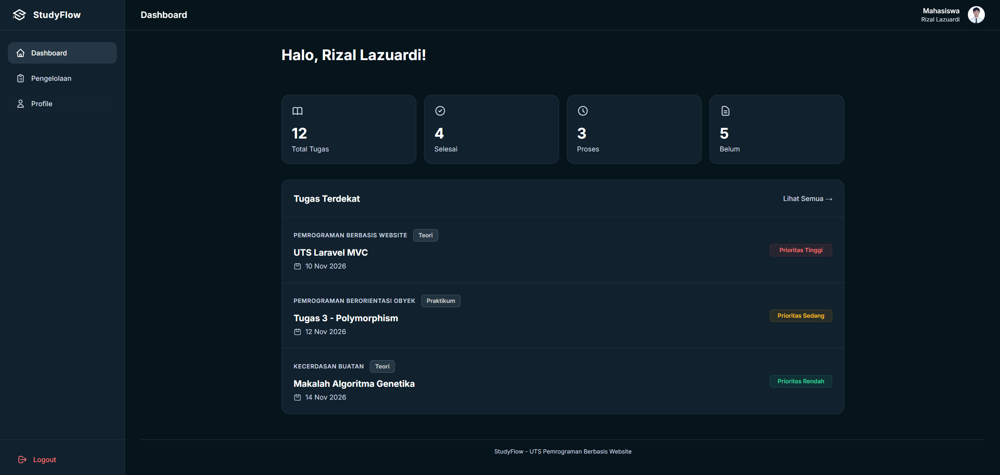
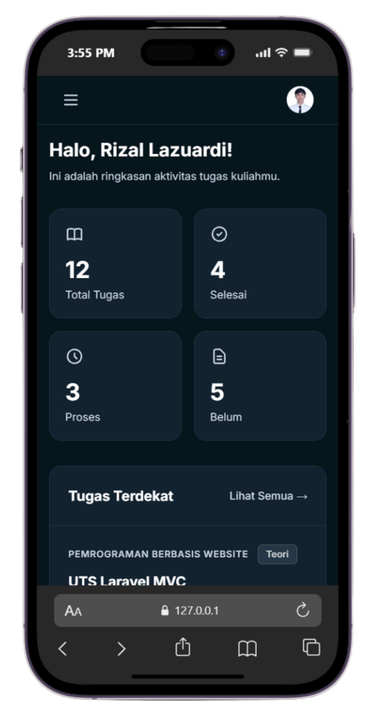

# StudyFlow - Aplikasi Manajemen Tugas Mahasiswa

**Tugas UTS Pemrograman Berbasis Website**
*   **Nama:** Rizal Lazuardi
*   **NIM:** 252410103045
*   **Kelas:** [Isi Kelas Kamu, misal: TI - C]
*   **Program Studi:** Informatika

## Tentang Aplikasi
**StudyFlow** adalah aplikasi web manajemen tugas (To-Do List) yang dirancang khusus untuk mahasiswa. Aplikasi ini membantu mahasiswa dalam memantau tugas Teori dan Praktikum, melihat statistik tugas, serta memprioritaskan tugas berdasarkan tenggat waktu (deadline) terdekat.

Aplikasi ini dibangun menggunakan framework **Laravel 11** dengan menerapkan arsitektur **MVC (Model-View-Controller)** dan **Tanpa Menggunakan Database / CRUD**. Data tugas dan pengguna disimulasikan menggunakan *Array* di dalam Controller (Request Handling).

### Fitur Utama:
1. **Simulasi Login:** Meneruskan *username* ke halaman Dashboard dan Profile menggunakan parameter URL.
2. **Dashboard Statistik:** Menampilkan ringkasan total tugas, tugas selesai, proses, dan belum dikerjakan.
3. **Pengelolaan Tugas:** Menampilkan daftar tugas lengkap (Teori & Praktikum) yang diurutkan secara otomatis berdasarkan deadline terdekat.
4. **Filter Interaktif:** Menyaring tugas berdasarkan kategori Teori/Praktikum menggunakan Alpine.js tanpa me-reload halaman.
5. **Desain Modern:** Menggunakan Tailwind CSS dengan tema *Dark Mode* yang elegan dan responsif di berbagai ukuran layar (Desktop & Mobile).

## Teknologi yang Digunakan
*   **Backend:** Laravel 11 (PHP 8.2+)
*   **Frontend:** Tailwind CSS (via CDN), Alpine.js, HTML5, Blade Templating Engine
*   **Arsitektur:** MVC (Model-View-Controller) tanpa Database

## Tampilan Antarmuka (Screenshot)

### Versi Desktop
*(Tampilan Dashboard Tugas di Desktop)*

<p align="center">
  
</p>

### Versi Mobile
*(Tampilan Responsif di Layar HP)*

<p align="center">
  
</p>

## Cara Menjalankan Proyek Secara Lokal
Jika ingin menjalankan proyek ini di komputer lokal (misal: menggunakan Laragon atau XAMPP):

1. Clone repositori ini:
   ```bash
   git clone https://github.com/username-kamu/UTS_PWEB_252410103045.git